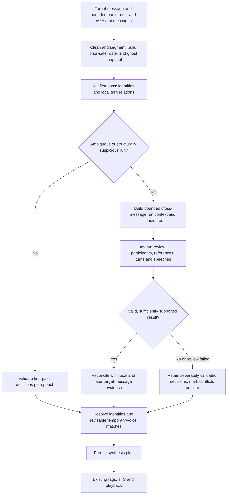
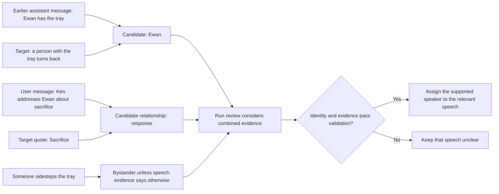
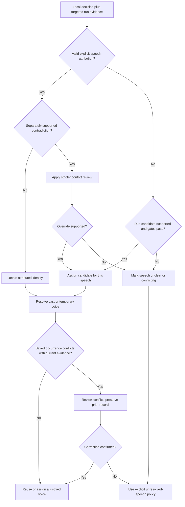

# Reader-inspired speaker identification: technical implementation design

## Status and scope

**In progress.** This document translates [the reader-inspired proposal](reader-inspired-speaker-identification.md) into an implementation plan for the `global-context` branch. The cross-message opening review, run-level context questions, explicit unresolved-speech routing, contested-occurrence checks, bounded provenance for newly saved occurrences, and a default-off shadow comparison are implemented experimentally. A separate opt-in can use the leaner question set for live review and can be switched back; it is not yet the complete proposed run-review design and has not passed a measured rollout. Legacy occurrence keys remain readable; full migration/rollback protection across older clients, an exhaustive scene model, optional LLM escalation, and a measured rollout remain proposed. Current code and tests are authoritative.

The immediate target is accurate attribution of ambiguous dialogue across the boundary between a preceding user or assistant message and the target message. The system should use scene participants, actions, addressees, dialogue content, pronoun references, channels, and later clarification within the target. It must not assume that a person mentioned in narration is the speaker, that the message author speaks every quotation, or that the prior speaker continues.

Non-goals for the initial implementation: an exhaustive persistent world model; deterministic gender inference from names; access to messages after the target; automatic rewriting of past audio; a new external API or a separate Jev account; and autonomous deletion or merging of cast or temporary voices.

## Current integration points and limitations

The following describes the checked-in `global-context` implementation, not all historical branches:

- `buildSpeakerDecisionPlan` in `src/core.ts` extracts paragraphs, quotations and within-message dialogue runs, then asks Jev about paragraph subjects, individual speeches, and adjacent-turn relations. A paragraph has one subject decision, not a set of actor/action relationships. Turn questions are dropped if the first pass exceeds the 256-question limit.
- `queueSpeakerParse` in `src/backend.ts` loads the chat, constructs the roster and global context, performs the first Jev call, and may perform an assistant/user review and one targeted relationship/scene review. It calls `resolveSpeakerDecisionSegments` with `evidenceOnly: true`; the branch no longer supplies the old previous-speaker or card fallback as a forced answer. The chain decoder still uses local and turn evidence, and can fill an unresolved identity.
- `relationshipReviewContext` includes up to the configured number of earlier user and assistant messages, default six, in chronological order. It takes up to 4,000 characters from each message, with a 24,000-character message budget; eligible temporary-voice context has a separate 12,000-character budget. Prior-only filtering is important for out-of-order playback.
- `buildRelationshipSpeakerReview` adds up to 32 targeted speech questions, with independent focal-actor, secondary-actor and actor/speaker-link choices when narration is available. These are answered in one Decision request; the choices are not a sequential reasoning chain and must not be assumed independent. Current separate gates can leave mutually reinforcing conversational evidence unresolved.
- `decodeSpeakerChain` scores within-message relations. It does not explicitly model the first target quote as a reply to the preceding user message. A mistaken high-confidence anchor or weak candidate can still influence downstream assignments.
- Temporary voice assignment occurs after parsing. `collectUncastVoiceGroups`, `buildUncastVoiceDecision`, `buildUncastIdentityReview`, and `resolveUncastVoiceDecisions` group and match uncast speeches. Today, an exact occurrence may take precedence when finding a ghost; that can preserve an earlier wrong interpretation.
- `CachedMessageParse` stores segments and compact discourse diagnostics. Cache keys are built in `queueSpeakerParse` from message, roster, context and schema versions. The frontend separately requests speaker parsing and uncast matching, freezes the synthesis plan, and sends TTS jobs. It currently has a 70-second speaker-parse timeout and a 35-second uncast-match timeout; individual Decision evaluations are subject to host limits. These are existing limits, not latency targets.
- The extension can call the default Decision connection via `spindle.decisions.evaluate` and can request normal model generation via `spindle.generate.quiet` for existing features such as card scanning and TTS tag placement. Do not assume JSON-schema enforcement, cancellation support, provider token reporting, prompt caching, model choice, or shared-context billing without verifying the host API and selected provider. Continue using the active `userId` and the host's access/permission model; do not add a direct provider client or store credentials.

The existing [Jev pipeline document](jev-speaker-pipeline.md) contains useful historical constraints, but some of its branch/status descriptions predate `global-context`. The code and tests are the baseline for implementation.

## Proposed architecture

```text
target + earlier messages + safe roster/ghost snapshot
  -> deterministic segmentation and bounded context selection
  -> existing Jev first pass (local identity + current turn relations)
  -> local trigger assessment and run candidate selection
  -> targeted cross-message/run review (Jev; optional LLM escalation later)
  -> deterministic validation, reconciliation and per-speech decisions
  -> temporary identity / voice matching with revisable occurrence evidence
  -> frozen synthesis plan -> existing TTS tags and playback
```

The first production slice reuses Jev and the existing segmentation, question batching, thresholds infrastructure, run detection, voice routing, tag pipeline and playback. It replaces overlapping targeted relationship/scene decisions for selected runs with a run-oriented review. Keep legacy functions available behind an explicit development/shadow switch until regression and latency evidence supports removal. Never run both policies and silently combine their answers.

### End-to-end decision flow



This is the proposed live path. Optional LLM escalation is a separately controlled experiment, not a required step or a replacement for validation.

### Resource roles

1. **Deterministic code:** preserve text and offsets; form bounded runs; select prior-only evidence; validate IDs and outputs; enforce hard scene/role/channel safety conditions; reconcile and route voices; maintain cache, diagnostics and cancellation state. It must not guess identity from a name's apparent gender.
2. **Jev / Decision API:** make bounded categorical judgments against explicit candidates and return its choice, probabilities and confidence where the host supplies them. Treat these values as provider/model scores, not calibrated probabilities or independent measurements. The default Decision connection remains the source; no hard-coded Jev model or separate credential.
3. **Optional `spindle.generate.quiet` LLM escalation:** a later, opt-in experiment for a small number of hard runs. It may propose a compact structured interpretation with text evidence. Its confidence, if provided, is not calibrated and does not bypass verification. Do not require it for the initial slice or add a mandatory extra model call to every message. Connection/model selection, permission, cancellation, structured-output support and token usage reporting must be checked against the host before implementation; reuse a supported user-configured connection policy rather than assuming the TTS tag-placement connection is suitable.

## Data contracts

These TypeScript-like contracts specify logical data, not final serialized schemas. Keep wire and persisted schemas versioned and validate all data at the boundary.

```ts
type EntityRef =
  | { kind: 'cast' | 'ghost' | 'user'; id: string }
  | { kind: 'unknown'; localId: string }
  | { kind: 'unclear' }

type EvidenceRef = {
  messageId: string
  role: 'user' | 'assistant'
  // Offsets are UTF-16 indices into a versioned, cleaned message snapshot.
  start: number
  end: number
  textHash: string
}

type SceneFact = {
  id: string
  kind: 'action' | 'reference' | 'address' | 'presence' | 'channel'
  subject: EntityRef
  object?: EntityRef
  evidence: EvidenceRef[]
  // Model output plus deterministic gate, not a claim of calibration.
  source: 'text' | 'jev' | 'llm-proposal' | 'cached-assignment'
  decision?: { choice: string; probability: number; confidence: number; margin: number }
}

type RunReview = {
  runId: string
  channel: 'in_person' | 'phone' | 'text' | 'other' | 'unclear'
  speechIds: string[]
  candidateIds: string[]
  facts: SceneFact[]
  results: Array<{ speechId: string; speaker: EntityRef; evidenceIds: string[]; outcome: 'assigned' | 'unclear' | 'conflict' }>
  version: string
}
```

Assign paragraph and speech IDs from the existing cleaned target plan. Prior-message evidence uses cleaned snapshots with roles and message IDs; never use numeric differences between message IDs. UTF-16 offsets refer to the exact cleaned snapshot sent to Jev, not raw markup. A normalizer version and snapshot hash must accompany any persisted offsets. Reject out-of-range spans, unknown messages, unknown speaker IDs, duplicate speech IDs, non-finite scores and fabricated evidence; never let generated offsets rewrite dialogue text. A local unknown ID is scoped to the current run/message until a separate identity review confirms a stable ghost.

Narrative facts are evidence, not voice routes. A single paragraph may contain several people and actions; the system must represent uncertainty and must not equate its focal actor, addressee or bystander with the speaker without a separately supported relationship.

## Stage A: context and candidate preparation

1. Reuse `relationshipReviewContext` to select up to the configured count of prior messages of either role, preserving order and stripping configured tracker blocks. Preserve the existing default of six messages and the current character budgets initially; measure truncation. The current saved setting retains its numeric value and now counts messages of both roles.
2. Supply the entire cleaned target message, its structured quote spans and the relevant earlier exchange. Prefer the latest prior user/assistant messages and their relevant dialogue; preserve boundaries and role labels. Build temporary-voice evidence from eligible, prior-safe aliases and bounded history. Exclude future-only ghosts, future messages and post-target evidence when replaying an older message.
3. Build a bounded candidate set from configured speakers, safe active ghosts and the user, plus `uncast` and `unclear`. Include names/aliases and short relevant evidence; do not include arbitrary unrelated cast merely because it exists. Selection is a recall-sensitive optimization: preserve explicit local names and leave a safe `other/uncast` path so pruning cannot force a wrong known identity. Defer any candidate-ranking algorithm until evaluated against the regression corpus. If the host's 255-choice or 256-question limits would be exceeded, split deterministic batches or return an explicit degraded/unclear result; never silently drop the identity of an actual local speaker.
4. Supply a genuine single-character card as an explicit weak prior in the model state, not an automatic answer or a numerical bonus applied after evaluation. If card classification is uncertain, provide no prior. World/scenario titles and ambiguous multi-character cards are not a default speaker.

The context and candidate builder should be pure and independently testable. It must preserve the current setting semantics and protect users' existing saved voice settings.

## Stage B: first pass and run selection

Reuse the first Jev pass and quote extraction initially. In addition to the existing local scores, derive review triggers without assuming they are independent probabilities:

- An ambiguous opening quotation plausibly responding to the preceding user or assistant exchange.
- Unresolved or uncast dialogue, weak margins, conflicting paragraph/speech decisions, uncertain turn-chain decode, or a previously clear identity contradicted by a strong local attribution.
- A potential channel or scene change, someone entering/leaving, or an actor/bystander distinction that affects attribution.
- A named/unnamed ghost conflict or a saved occurrence that differs from new evidence.

Use `dialogueRunDrafts`/`assessSpeakerDiscourseEscalation` as starting points, but extend the run representation to include a **boundary exchange**: the relevant earlier utterance(s), their role and text evidence, without pretending every quotation in a user message was said by the user. Treat broad trigger detectors as candidates for review, not evidence of a particular speaker. Evaluate false negatives on confidently wrong examples, not only low-confidence cases.

If no trigger fires, use the accepted first-pass decisions. A first pass that appears clear is not guaranteed correct; this is a cost/recall tradeoff to evaluate. For selected runs, prepare one compact review request that contains the full target, the bounded preceding context and candidate identities. Preserve later target text for bounded re-read. Keep no later chat messages.

## Stage C: cross-message and scene review

### Initial Jev implementation

Use the existing `spindle.decisions.evaluate` request mechanism. Submit a bounded set of questions for a selected run, with one shared state containing message roles, current speech IDs, candidate descriptions, pertinent narration and prior exchange. Questions can ask:

1. What is the relationship between the first target utterance and the relevant preceding utterance: same speaker, response, third-person interjection, unrelated/new exchange, or unclear?
2. Who is addressed in the preceding exchange, when the text supports an answer?
3. Which candidate owns a relevant narrative reference/action, and is that person a speaker, addressee, bystander or unclear in the run? Permit multiple separately referenced actors; do not collapse an entire paragraph to one speaker.
4. Who speaks each selected quotation, considering the complete exchange, topic, actions, pronouns, named references and channels, including later evidence within the target?

The Decision API's categorical answers are generated together. Do **not** assume one question sees another question's answer, and do not turn agreement among related questions from one call into statistically independent evidence. Each question must identify its own quoted span and evidence context; a link question must define the exact reference it concerns rather than refer to an unspecified “focal actor.” The current per-speech focal/secondary questions can be replaced or narrowed where this run-level design provides equivalent evidence.

Include explicit `unclear`, `other/uncast`, and, for role/channel questions, appropriate `not_established` options. Match Jev choices to stable candidate IDs; reject invalid options and missing/partial results gracefully. Issue no more than the host question/choice limit; include an explicit batch ID and merge results only after validating the same context snapshot and schema. For long runs, use overlapping bounded windows with boundary evidence and flag inconsistent overlap for review rather than forcing agreement.

### Re-read within the target

The run review sees later target text at the initial review. An implementation need not make a separate re-read request when that text is already available. If later text names or explicitly attributes an earlier participant, propose a link only if the intervening scene supports it. A new entrant, scene change or off-scene channel is not a backward identity link by itself. Preserve the evidence spans used for any changed result.

### Optional LLM escalation, not MVP

If the Jev run review remains unresolved and the user explicitly enables an advanced escalation mode, consider one `spindle.generate.quiet` request for a bounded run. Ask for candidate IDs, per-speech assignments or `unclear`, actor/action/addressee relationships and short references into supplied text. Treat the conversation as untrusted data, not instructions. Parse and strictly validate the response; no invented names, rewritten quotations, future references or out-of-scope IDs. A model-generated narrative rationale is a proposal, not proof and not a calibrated probability.

Before this mode can alter routing, require a separate bounded validation/verification policy, evaluate it against Jev-only results, and define the maximum additional calls and deadline. If parsing or verification fails, discard the proposal and retain a safe unresolved/previously validated result. No provider-specific structured-output or token-usage guarantee may be assumed.

### Example: bridging Ewan's opening reply



The arrows express candidate evidence, not deterministic identity rules. Each quote is evaluated individually within the run; the bystander may become a speaker if the text later supports it.

## Stage D: deterministic reconciliation

Create a single reconciliation function for each speech; do not let multiple stages overwrite the same identity without recording the source and conflict. Initial policy:

1. Validate local, turn, run and narrative evidence independently, respecting explicit scope and channel. Distinguish the existence of a textual attribution from an LLM's inferred attribution.
2. Keep a locally explicit attribution unless a separate, well-supported contradiction justifies a review. A named actor alone is not an explicit speech attribution.
3. For an unresolved or structurally conflicting speech, accept a run-review candidate only when its configured gates and supporting evidence pass. For an existing clear assignment, require a stricter override policy and explicit contradictory evidence. The existing local gates (0.5 probability, 0.5 confidence, 0.15 margin) and existing override gates (0.7/0.65/0.25) are baselines for experiments, **not calibrated acceptance guarantees**. The present relationship review has its own stricter thresholds; do not silently replace them. Choose final thresholds with evaluation and record the chosen version.
4. Preserve an `unclear` or `conflict` outcome if the model is uncertain, the anchor/link is unsupported, results are missing, or competing candidates cannot be distinguished. Do not use a previous speaker, a card title or a background actor as a blanket fallback.
5. Allow local within-run chain evidence only within scene/channel boundaries. Do not let a low-confidence chain fill bypass unresolved global conflicts or independently override a validated cross-message run result. Audit the current `relationship_continuity_*` protection and chain policy rather than treating either as universally authoritative.
6. Once a final stable speaker identity is selected, use the existing segment/tag/voice pipeline. Narration must remain narrator audio; unresolved speech must remain identifiable as **speech**, not be relabeled narration. Define an explicit unresolved-speech route using existing connection/default/temporary-cast policy and report that choice; never silently use the narrator solely because a speaker ID is null. This needs frontend/backend integration tests.

The first-slice behavior on review failure is to retain only separately validated first-pass/local results, keep uncertain conflicts unresolved, and continue playback using the explicit unresolved route. No scene-wide inheritance or forced single-card result is restored on failure.

### Per-speech reconciliation and routing



Narration remains narrator audio throughout. A saved occurrence is a clue, not proof, and an unclear speech must not be relabeled as narration.

## Stage E: revisable temporary voice matching

Update the uncast matcher so an occurrence is an evidence record, not an irrevocable identity:

- Bind occurrences to message ID, message content hash, a stable speech-span/group fingerprint, ghost ID, identity-decision version and evidence provenance. Text hashes alone must not imply a correct speaker.
- A newly validated cast identity should route to its configured cast voice; a validated ghost identity may reuse that ghost's voice. A mismatch between current review and prior occurrence must enter conflict review, not silently favor the occurrence.
- If evidence is too weak to resolve a conflict, avoid destructive merges or silent reassignment. Keep the old saved record recoverable and route this playback using the safe unresolved policy. A fresh voice choice is not proof of a different identity.
- On a confirmed correction, update only the affected occurrence after verifying message hash, current chat state and playback request generation. Preserve user-configured mappings and do not delete ghosts merely because an automated model changed its mind. Do not automatically regenerate already saved audio; users can explicitly regenerate it.
- Gender categories are voice-selection hints, not identity proof. Do not infer gender from a name such as Halloran, and do not treat a gender mismatch alone as conclusive evidence of different people.
- Preserve alias-based recognition, user-controlled promotion to regular cast, invocation-based expiry and bounded rolling history. Use chronological message order, not ID arithmetic, for lifetime and out-of-order checks. Explicit user edits/deletions and existing managed-voice ownership take precedence over inferred data.

Plan migration for existing `occurrenceKeys` and continuity records: read legacy entries as **unverified historical evidence**, not as validated provenance; write new records under a versioned schema; do not bulk delete existing state. Provide rollback to the old reader and prevent an older client from overwriting richer new records. Test multiple clients and concurrent regeneration.

## Concurrency, playback and failures

- Perform context construction and review before freezing speaker identities for the affected synthesis plan. TTS tag selection that does not depend on final identity may run concurrently only when safe; any speaker-dependent emotion continuity must use the reconciled identity. Existing narration, emotion, sound/VFX and pause paths must continue to work for cast and ghost voices.
- Do not play speculative dialogue with one voice while a review may replace it. An optional future optimization could start **unaffected narration** early, but only after proving ordering, cancellation, cache and playback behavior. Do not promise zero perceived pause; measure time to first audio and first affected speech.
- Match responses to chat/message/request ID, content/context hash and monotonically increasing request generation. A stopped, superseded, edited, rerolled or different-chat request may not mutate the active plan or persist an identity. Honor abort signals where the host supports them; where it does not, ignore late results and account for their cost. Freeze the plan once committed, and never splice late answers into already playing speech.
- On Decision/LLM timeout, invalid or missing answer, capability/permission failure, or question-limit overflow, record the exact degradation and proceed with validated existing decisions and explicit unresolved routing. Do not cache a partial failure as a successful result. Preserve actionable user-facing errors for missing permissions/connections.
- Preserve queue serialization and merge against freshly loaded metadata. Define lock ordering for parse and ghost updates to avoid deadlock; guard against two devices racing to create/rename a ghost or overwrite a newer user edit. No mutation of state on a stale generation.

## Caching and invalidation

Start by extending the existing `CachedMessageParse`/hash rather than introducing a second persistent cache. A review key must include target and cleaned-text hashes, ordered prior message IDs, roles and content hashes, selected snippets and truncation/version policy, roster IDs/aliases and card prior, safe ghost identities/aliases/context/history snapshot and lifetime, relevant user/persona state, skipped tracker configuration, feature settings, model/connection identifier **where the host exposes a stable one**, review/prompt/schema/threshold versions, and relevant provider capability version. Hash sensitive text rather than exposing it in ordinary logs. If connection/model identity is unavailable, document that limitation and invalidate conservatively when settings or capability change.

Out-of-order replay keys must contain only evidence allowed before that target; deleted, renamed, expired or changed ghosts invalidate affected entries. Editing any referenced earlier message, changing a roster alias or voice configuration, rerolling the target, changing the context count or upgrading the decision schema must not reuse stale results. Cache only complete validated decisions; keep narration/speech span alignment verifiable. Avoid storing generated reasoning or raw private history beyond the existing user-controlled context retention policy.

## Privacy, security and diagnostics

The user has requested prior user and assistant messages as context; send only the configured bounded window and the necessary safe temporary-voice evidence to the configured host/provider. Chat text, card content, aliases and LLM output are untrusted data. Instructions must explicitly reject instructions embedded in that content; validate all outputs and never execute them.

Debug mode should include run ID, target speech IDs, channel, candidate IDs, role-labeled context message IDs and truncation counts, anchor/action/addressee references, cross-message relation, selected/rejected choices and gates, conflict and occurrence provenance, request count, durations and freeze/failure status. Use source span IDs/hashes and short, user-visible excerpts only under existing explicit debug controls; avoid raw history, credentials or provider payloads in normal logs. Do not claim model rationale is ground truth. Report token counts and price only if the provider exposes actual usage and configured pricing; otherwise report characters, questions and call counts as proxies.

## Cost and latency controls

**MVP budget:** reuse the existing six-message default, 4,000-character per-message limit, 24,000-character prior-message cap and 12,000-character ghost-context cap. These are current character bounds, not guaranteed token limits. Review only triggered runs, batch them when question/choice limits allow, and replace rather than duplicate the current scene/relationship review. Preserve deterministic segmentation and the single existing first-pass call. Bound run count, quotes, candidates and per-run evidence with explicit diagnostics when truncated; proposed caps must be chosen after fixture measurements, not hidden constants.

Record per request: first-pass/review/voice-match call counts; input characters by current/prior/ghost context; question and candidate counts; cache hit; call durations and failures; time to first audio and first affected speech. If actual input/output token usage is exposed, record it. Otherwise do not equate character estimates with billed tokens. The Decision provider may bill or process shared context once per call, per question, or in another way; benchmark this instead of assuming batching is free.

For pricing evaluation, use measured usage and the user's configured provider rates:

```text
incremental cost = additional input tokens * input rate
                 + additional output tokens * output rate
                 + any provider-specific request charges
```

Measure paired baseline/candidate runs at p50/p95 and report total latency, time to first affected speech, accuracy and unresolved rate. Set explicit release budgets and timeout/stop behavior from those measurements and user preference; do not publish invented dollar figures or promise a fixed latency reduction. Optional LLM escalation must have a separate, default-off call/token/time budget.

## Testing and acceptance

Add deterministic unit tests for pure context selection, stable speech/scene references, role labels, truncation and budgets, no-future evidence, safe ghost aliases, participant/action scope, question/choice limits, malformed/missing model answers, and prompt/scene metadata. Use recorded/mock Jev decisions for integration tests; do not make network model calls part of `npm test`.

Regression fixtures should contain the actual user/assistant sequence and expected **per-speech** assignments, voice routing and unresolved outcomes, including:

- Ewan/tray/sacrifice: Ewan is the addressee and tray carrier; the sidestepping person is not automatically the speaker; nearby text-message channel is distinct. Mock a supported cross-message response and test that an uncertain/contradictory review does not force Ewan.
- Halloran: an established ghost and its named alias resolve consistently; a bystander entering is not automatically the next speaker; an incorrect legacy exact occurrence can be challenged without deleting user data.
- Tessa and Marisol: identify phone participants and a later name reveal without conflating caller, recipient and user; retain aliases and voice where justified.
- A scene with two active speakers, a new third speaker, misleading pronouns, ambiguous pronouns, a single-character card and an RPG/world card; named cast, ghost, user persona and genuinely unknown speakers.
- Out-of-order playback, edited prior messages, rerolls/swipes, tracker stripping, deleted/expired/renamed ghosts, user voice changes, stale cache keys, multiple devices and cancellation/late responses.
- No-Decision capability, missing connection, timeout, invalid JSON/choices, question-limit overflow, no earlier context, uncertain speaker routing, ghost creation disabled, and the same emotion/VFX/pause processing for cast and temporary voices.

Use a separate opt-in evaluation corpus of anonymized or user-approved real passages with labeled speakers, narration references, boundaries and genuine ambiguity. Split evaluation by conversation rather than by quote to avoid leakage. Track per-speech accuracy, incorrect confident assignments, unresolved rate, unknown/ghost recall, cross-message opening accuracy, bystander false positives, identity/voice continuity, and regressions by channel. Compare against `global-context` baseline; require user approval of concrete accuracy/cost/latency budgets after collecting measurements. Do not tune solely to the Ewan wording or a small set of examples.

An offline paired-decision scorer is available as `npm run evaluate:speakers -- path/to/labeled-decisions.json`. See [the synthetic example](examples/speaker-review-evaluation.synthetic.json) for its format. The JSON is an array of cases with unique `id`, `conversation`, and aligned `expected`, `baseline`, and `candidate` arrays. Each item is a stable speaker ID or `null` for unresolved; optional `baselineMs` and `candidateMs` are measured per-case durations. It reports aggregate exact matches, unresolved rates, paired improvements/regressions and nearest-rank p50/p95 durations. It does not run Jev, collect model decisions, infer confidence, measure token usage or cost, or prove generalization. Use independent, conversation-separated real evaluations with appropriately reviewed labels; do not interpret synthetic test scores as model accuracy. Keep the private input outside the repository unless explicitly approved.

The experimental run-focused live policy remains opt-in pending a representative paired evaluation. The current shadow comparison does not include all post-review reconciliation and opening re-reads, so its differences are not a complete-policy accuracy comparison. Debug traces separately preserve initial first-pass decisions and report final routing sources and elapsed-time proxies; they are not calibrated confidence, token or billing measurements.

## Rollout and implementation order

1. **Instrument and baseline:** add opt-in privacy-safe timings, question/context sizes and recorded fixtures; establish current accuracy and cost. No routing changes.
2. **Cross-message run plan in shadow mode:** build bounded context and Jev questions, validate outputs, and compare decisions without changing audible routing or writing ghosts. Fix run/candidate recall and untrusted-output failures. Shadow mode can increase cost and must be explicitly enabled.
3. **Targeted live review:** replace the overlapping global scene review for a limited set of triggered runs. Reconcile per speech, preserve unclear outcomes, and expose a rollback switch. Keep the first-pass and existing tag pipeline. Measure latency and accuracy; do not run both review systems by default.
4. **Revisable identity/occurrence migration:** implement provenance and conflict handling, migration/rollback, concurrent edit protection, and explicit unresolved-speech routing. Do not silently alter existing saved audio or user mappings.
5. **Broaden triggers / bounded re-read:** expand to other conversation runs only when evaluation demonstrates improvement within accepted budgets. Consider LLM escalation separately, default off, after Jev-only evidence.

Every phase should run `npm run typecheck`, `npm test` and the repository's extension rebuild when source changes. Promotion requires passing regression and privacy checks, no future-message leakage or unsafe mutation, acceptable measured latency/cost, and a rollback path.

## Open decisions

- How many review runs and questions per message best balance recall and provider cost, and how does the configured Decision provider bill a batch?
- Can the host expose stable model/connection identity, actual token usage, per-request cancellation and structured output without introducing a separate credential?
- What user-facing policy should handle unresolved speech: connection default, an existing generic uncast voice, or another explicit choice? How should it appear in the drawer and debug log?
- What evidence and consent are sufficient before automatically replacing a previously saved occurrence, and how long should reversible provenance be retained?
- Should an optional retrospective mode ever use later chat messages? If so, it requires separate user control, branch/swipe isolation and spoiler/privacy expectations.
- What exact latency, cost and accuracy targets should gate promotion? These must be chosen after baseline measurements.
# Opening-link formulation comparison

With comparison and debug enabled, an unresolved opening additionally gets a separate boundary-exchange shadow review. It receives the bounded opening and preceding messages, identifies each unresolved quotation independently, and checks synthetic continuation, interruption, reply, and unclear controls. Its answers are diagnostic only and never apply to routing. It uses the configured Jev connection and can add another request and up to five seconds of waiting; a timed-out request may continue in the host. Synthetic controls are not evidence of real-world accuracy.

When both speaker-assignment debug and experimental comparison are enabled, an eligible opening-link review also runs a separate, non-routing Jev comparison. It asks whether the two current-message speakers are the same, different, or unclear, and includes synthetic continuation, reply, and ambiguous controls. The expected control labels are kept outside the request. The debug log reports the live answer, candidate probabilities, and control answers; the two formulations have different answer categories and are not directly interchangeable.

This uses the configured Jev connection, not a separate model. It is a diagnostic sanity check, not an accuracy measurement or a replacement for testing real conversations. It can add cost and up to five seconds of waiting; a timed-out host request may continue in the background. It does not change routing, cast, or the live decision cache.

