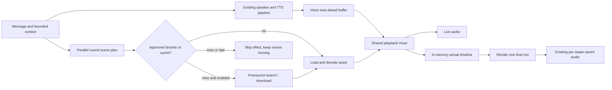

# Scene-aware sound effects for Chat Voice

Status: implementation in progress; an experimental manual favorites library is available, but scene planning, effect playback, and final mixing are not implemented.

Branch: `sound-effects`

Research: 2026-11-24

Initial implementation: `src/sound-library.ts` provides per-user favorite records and binary write/read/list/edit/remove primitives. The experimental drawer can add, preview, edit, and remove user-provided sounds; browser-side decoding checks a 120-second maximum, while backend checks container signatures and limits each file to 24 MiB. Files above 2 MiB transfer in 1 MiB chunks through an authenticated frontend session; temporary upload and download buffers each have a 64 MiB runtime cap and expire after inactivity. Downloads use a single per-session file snapshot and release it when finished or cancelled. Chunked transfers and host binary-storage limits require real-host testing. Backend signature checks are not a full decoder and the RPC does not prove a client performed the browser-side check; independently validate any asset before automatic playback. Preliminary per-user limits are 200 favorites and 100 MiB within one backend runtime; cross-runtime quota enforcement and orphan reconciliation remain open. Mock-storage tests cover user isolation, object recreation, concurrent additions, corrupt metadata, and failed writes. Object recreation in a mock is not an uninstall/reinstall test. Provenance, portable backup, robust host transport, and the real-host lifecycle gate remain required before release.

An experimental, default-off event-sound option starts scene planning and a bounded favorite-asset prefetch alongside voice synthesis. It sends the current message and favorite-sound names, descriptions, tags, types, and IDs to the selected generation connection and model. Competing candidates anchored to overlapping text receive optional batched review through the default Decision connection, which also receives the message and relevant candidate metadata; both destinations are disclosed beside the opt-in. Event mode adds natural clause boundaries to eligible narration, and playback selects ready, unambiguously aligned events at each boundary; sounds that miss their boundary are skipped. Saving waits until playback finishes or stops so it can use the same selected event sequence in one WAV. Events are capped at five seconds. Favorite previews and playback use category gain with RMS targets and peak limits; quiet ambience is not boosted. Separate category volume controls default to 80% for events and 25% for ambience and apply to newly generated audio and previews, not existing saved recordings. This is not perceptual loudness measurement. The drawer groups the experimental library and Freesound credential controls into Effects, Library, and Advanced tabs; the credential uses per-user encrypted enclave storage. Manual Freesound metadata search, browser-side preview, and explicit CC0 preview import are available. Import preserves source metadata and rejects non-CC0 licenses until saved-recording attribution is implemented; automatic fallback is also not implemented. Browser CORS, transfer limits, and real-host integration remain unverified. The experimental path requires real-host end-to-end verification, including saved audio, stopping, rerolls, concurrency, and mobile autoplay; unit tests are not that verification.

An experimental, independently default-off ambience option now uses the same scene planner to start and stop ready favorite ambience at clip boundaries. Matching favorite ambience can be prefetched alongside scene planning. If a start cue is reached before its asset is ready, it may begin at a later boundary unless a stop or replacement cue has superseded it. It mixes ambience into each voice and event clip with continuous loop phase and fade-in, and the saved recording uses the same mixed clips. This is clip-level mixing, not a continuous background player: ambience pauses during buffering gaps and fade-out is not yet implemented. Memory use, stop/regeneration semantics, exact live-versus-saved timing, and end-to-end behavior require real-host verification before release.

## 1. Product goal

Make generated chat audio feel like a coherent audio drama, not a sequence of speech, an unrelated sound, and more speech. A listener should continue to use the existing play button, autoplay, message/swipe controls, and saved-audio UI. The feature is optional and must not worsen voice-only playback when disabled.

- Blend quiet, continuous ambience with voice.
- Inject a small number of meaningful sound events **between** narration or dialogue segments. Voice pauses for an event and resumes afterward; ambience may continue beneath both, but an event must never overlap spoken words.
- Favor user-approved audio assets, then an expendable cache, then an optional live Freesound search. A missing or late sound should normally be skipped, not hold up narration.
- Preserve only **one final mixed audio recording** per saved message swipe. No user-facing separate tracks or persistent effect timeline are needed for playback.
- The user's favorite library and its audio must survive an extension uninstall/reinstall on the same Lumiverse data store and user account.

Non-goals for the first release: composing music, automatically voicing background characters, selecting a sound for every action, promising exact word synchronization, or changing the existing text, speaker identification, or voice synthesis semantics.

## 2. Verified Lumiverse storage and lifecycle

The following findings distinguish documented APIs from behavior observed in a specific host revision. They are not an assertion that every deployed Lumiverse version has identical behavior.

| Facility | What it provides | Design use / limitation |
| --- | --- | --- |
| `spindle.storage` | Extension-scoped UTF-8 and binary file operations. Its scope differs for operator- and user-scoped installations. | Not the durable library contract: the documented [removal lifecycle](https://docs.lumiverse.chat/lifecycle/) deletes the extension installation directory and its storage. Do not rely on the operator installation directory surviving. |
| `spindle.userStorage` | Per-user, per-identifier storage at `{DATA_DIR}/users/{userId}/extensions/{identifier}/`. The installed `lumiverse-spindle-types` 0.6.79 defines `readBinary`, `writeBinary`, `getJson`, `setJson`, `move`, `stat`, and deletion methods with user context; the [published storage guide](https://docs.lumiverse.chat/backend-api/storage/) documents per-user isolation but currently omits the binary methods from its user-storage table. | Primary store for favorite metadata and bytes. Always use this API explicitly for both operator- and user-scoped installs; never rely on `spindle.storage` resolving to the desired scope. |
| Host removal | In Lumiverse source revision [`d60addb2f0064b358bff7edf51d1c8bfc815908e`](https://github.com/prolix-oc/Lumiverse/blob/d60addb2f0064b358bff7edf51d1c8bfc815908e/src/spindle/manager.service.ts), `remove(identifier)` deletes the database extension row and `extensionDir(identifier)`; the [remove route](https://github.com/prolix-oc/Lumiverse/blob/d60addb2f0064b358bff7edf51d1c8bfc815908e/src/routes/spindle.routes.ts) calls that function after stopping the extension. The [storage host](https://github.com/prolix-oc/Lumiverse/blob/d60addb2f0064b358bff7edf51d1c8bfc815908e/src/spindle/worker-host-storage-api.ts) resolves user storage separately and handles binary reads and writes. | Source evidence that the ordinary removal path does not delete the separately rooted user library. This is an **observed implementation**, not an explicit lifetime guarantee in the lifecycle docs. Verify on the supported host version and installation scopes before shipping. |
| `spindle.files` / uploads / ephemeral storage | Staged binary files, frontend uploads, and temporary storage; staged files have a limited lifetime. | Staging/import/export only, **not** the sole copy of favorites. [File transfer docs](https://docs.lumiverse.chat/backend-api/file-transfers/) and [upload docs](https://docs.lumiverse.chat/backend-api/uploads/) specify lifecycle and limits. |
| Existing audio attachments | The extension currently submits generated audio to `/api/v1/tts/save-message-audio`, associates it with the selected swipe, verifies the returned target, and applies saved-audio retention. | Preserve that user-facing contract; render one final mixed file and save through the existing host mechanism. Verify support and returned attachment data on the supported host. |

### Reinstall-survival contract

For a standard uninstall and reinstall of `chat_voice` by the same user on the same Lumiverse server and data directory, favorites and their cached audio must be restored automatically, without asking the user to export first. Both operator- and user-scoped installations must use per-user APIs with the correct authenticated `userId`. A reinstall may create a new installation database ID, so the library must be keyed by stable user identity and the extension **identifier**, not the installation ID or chat ID.

This cannot survive deleting the user's Lumiverse data, changing accounts/servers, clearing the library explicitly, or a host upgrade that changes removal semantics. Moving the library to another server needs a supported transfer mechanism. Provide explicit, user-initiated export/import of favorites, metadata, and permitted audio as a recovery and migration path; it supplements automatic persistence, not replaces it. Include a clear library-delete action for users who want the retained data removed.

**Release gate:** exercise real uninstall and reinstall on each supported Lumiverse version in both install scopes, for multiple users; confirm favorite bytes, edits, indexes, previews, and saved mixed audio remain accessible, while another user cannot read them. Verify update, disable/enable, concurrent installs/sessions, and server restart. If the host deletes user storage in a supported version or binary APIs are unavailable, do **not** claim the contract is satisfied: coordinate a host-owned durable storage API or limit support until verified. Do not fall back silently to installation storage or browser-only storage.

### Storage model

- Store a versioned per-user manifest, for example `sound-effects/v1/library.json`, and bytes at generated internal paths such as `sound-effects/v1/assets/<content-hash>.<safe-extension>`. Never use a remote name or URL as a path. Store metadata and audio in `spindle.userStorage` with the same resolved user.
- Metadata includes stable asset ID and hash, display name, description/tags, favorite vs automatic-cache status, asset type, duration, chosen excerpt, loop eligibility, gain adjustment, source URL/ID, creator, license, attribution, creation/access times, and format/version. Preserve provenance even if an asset is later removed.
- Favorited assets are pinned and never evicted by automatic cache cleanup. Automatic discoveries are a separate bounded, least-recently-used cache. Set explicit per-file and aggregate budgets; show usage, failed writes, and controls to clear the expendable cache or deliberately delete favorites. Do not assume `userStorage` has the ephemeral-storage quota semantics.
- Deduplicate bytes by content hash within a user, while keeping separate metadata where needed. Verify MIME, size, decodeability, duration, and content hash before promoting an asset. Temporary writes and `move`/versioned manifests reduce partial updates; use per-user serialization and recovery checks so concurrent sessions cannot corrupt the index. Confirm the host's actual rename/overwrite semantics before implementation.
- Per-user server storage allows that user's desktop and mobile clients **connected to the same server** to share a library. It is not cross-server/cloud sync. Avoid storing audio as large settings values or base64 in chat metadata. Do not assume files are directly browser-addressable: design an authenticated, user-scoped transfer via existing backend messaging/chunking or supported file APIs, respecting frame-size and runtime limits. Staged downloads/URLs are temporary; copy validated data into durable user storage.
- Manage credentials separately from assets with `spindle.enclave` where available, never in favorite metadata, URLs, logs, or exported archives. Its uninstall persistence and the authentication UX must be independently verified; reconnecting an API account must not delete the sound library.

## 3. Existing pipeline and integration

Chat Voice currently resolves speakers, creates paragraph/size-bounded voice jobs, prepares TTS in parallel with adaptive look-ahead, decodes/normalizes clips in a browser `AudioContext`, and saves a per-swipe final recording. It also has autoplay, background save, abort, rate-limit, out-of-order, and swipe protections. The feature must integrate with these rather than introduce a second player, a second saved-audio attachment, or another unrelated play button.



The sound planner starts as soon as the target message and bounded context are available. It runs independently of TTS synthesis and must never block the existing speaker result or first voice buffer. Batch candidates per message; avoid a model/API request per effect. Starting an effect before its asset is ready must not wait for a network request. Give each cue an explicit deadline and bounded search/download concurrency; when missed, mark it skipped. Initial ambience can fade in only if it is still relevant and arrives within its bounded startup window; otherwise skip it rather than starting late in an unrelated scene. A small optional, user-controlled startup allowance could be explored later, not assumed for the prototype.

Use an immutable message/swipe/content snapshot and request generation token. Ignore late plans, downloads, or decision responses after abort, swipe, message regeneration/refinement, navigation, or a newer generation. Reuse the existing voice look-ahead, synthesis pacer, and playback startup ownership protections; sound network work must have its own bounded budget and must not steal voice synthesis concurrency or affect TTS rate-limit handling. Deduplicate in-flight asset fetches per user and asset, with independent consumers so one cancellation does not cancel another user's or playback's request.

## 4. Scene plan and model responsibilities

### LLM: read the scene and propose a compact plan

Run at most one bounded, structured sound-planning request per message in parallel with existing work. The model receives only the current message, a bounded preceding conversation/scene summary when available, segment anchors, and current ambience state. Instructions and external content are untrusted data, not commands.

The LLM proposes a few candidates, or none. It distinguishes events happening now from metaphor, past memories, speculation, and sounds merely mentioned in conversation. Each candidate contains a stable ID, category, concise search phrase, role (`ambience` or `event`), a verifiable text/segment anchor, approximate ordering, confidence/importance, and whether current ambience continues or ends. Event importance may help select a short or prominent beat, but does not change its between-voice placement. It must not invent timestamps, file IDs, licenses, or gain values. Validate the response schema, IDs, bounded lengths and counts, anchor text and offsets, and finite values. If the plan is malformed, late, unavailable, or indicates no meaningful sounds, fall back to voice only.

Ground each candidate in the nearby source and context: an actual present-scene action is evidence; a metaphor, remembered or hypothetical event, negation, or a character merely mentioning a sound is not by itself a reason to play one. Optional targeted Jev review may assess ambiguous grounding, but literal keyword matches are only one clue and must not be treated as proof. Do not require literal word overlap when the scene clearly implies a sound.

### Decision model / Jev: bounded choices and selective review

Jev is not another required call for every cue. Use it only where it can resolve a material ambiguity within a strict deadline: for example, choose among a small set of cache-first candidates and `none`, assess whether a doubtful event is present in the current scene, or review a conflict in ambience continuity. Good single matches can be chosen deterministically; failed, weak, or late reviews default to omit/retain existing ambience as appropriate. Existing speaker and vocal-tag questions keep their present responsibilities. Do not infer that Jev is always faster or cheaper: both model paths may use network services, and results must be measured per connection.

### Deterministic code: safety, policy, and audio

Code validates scene plans, licensing and asset eligibility; scores/cache-ranks metadata; enforces counts, deadlines, durations, gain bounds, and concurrency; loads/decode audio; schedules the mix; and performs persistence. A model response is never a direct file path, authenticated URL, command, precise timestamp, or unrestricted volume. Metadata can be misleading: neither model can establish sound quality or contents from a filename alone. Favor user-vetted assets and allow `none`; use simple ranking for the prototype, with optional Jev comparison only when useful.

### Example plan

```json
{
  "ambience": { "action": "continue", "query": "soft rain against window" },
  "events": [
    { "id": "e1", "role": "event", "anchorSegment": 3,
      "anchorText": "The phone rang.", "query": "telephone ring", "importance": "high" }
  ]
}
```

An anchor is a reference to validated source text, not an assumed word-level audio timestamp. Scene state should be bounded and per chat/session; do not leak ambience between unrelated chats or unrelated swipe variants.

## 5. Favorite library, cache, and Freesound

The drawer presents a favorites library inspired by favorite voices: search/browse, preview, favorite, edit, remove, and inspect source/license. Records expose user-editable name, description, tags, trigger words/aliases, type, per-asset level, optional start/end excerpt, and whether a sound is loop-safe. A favorite is an explicit user action; real-time results enter the expendable cache, not favorites automatically. Support easy promotion and replacement of poor matches, including a way to find another search result. Local user-provided files are a later slice, subject to the same size, isolation, provenance, validation, and portability rules.

Default prototype behavior should be opt-in: effects off until enabled. Once enabled, users choose **favorites only** or **favorites first, then live search**; default to favorites only until privacy, licensing, and network UX are validated. Favorite and cache search runs before external lookup. Select among several good event variants without immediate repetition; reuse the same ambient asset across consecutive messages while the scene continues.

Use a deterministic first pass: explicit user trigger words/aliases, exact normalized descriptions, then a conservative metadata similarity score, always with a no-match outcome. Give approved favorites priority over automatically cached items. Preserve discriminative action and context terms: `door opening` must not be treated as equivalent to `door slamming` just because both mention a door. Use Jev only for a short ambiguous shortlist, with `none fits`; if the review misses its deadline, use a previously vetted acceptable candidate or skip. Never force the first unvetted search result merely because the model timed out. Search queries can be progressively shortened when necessary, subject to a strict total request/deadline budget; a shorter query must still pass relevance and license checks.

Freesound search supports requesting needed fields in one response (ID, name, tags, description if needed, creator, license, duration, preview URLs), and filtering duration and license. [Its API guide](https://freesound.org/docs/api/resources_apiv2.html) notes previews and field selection; [preview retrieval](https://freesound.org/docs/api/overview.html) is different from downloading originals, which may require OAuth. Search uses an API credential, while preview delivery and original downloads have distinct access rules. Honor current rate limits and `429` handling; no key rotation to evade limits. Restrict outbound hosts and redirects, cap asset size/decode time, verify types, and avoid logging sensitive context. Use only short generalized queries by default; disclose that search terms are sent to the provider.

Freesound's [terms](https://freesound.org/docs/api/terms_of_use.html) state that free API use is noncommercial and require appropriate credit. Individual sound licenses differ. Offer explicit license filtering, display source/creator/license, and retain attribution metadata for sounds actually included in saved mixes even if the cached sound is later deleted. This attribution metadata is not a separate audio track or persistent playback timeline. Verify how to associate it with a saved host recording; if the attachment API cannot carry it, use a durable per-recording metadata index with deletion/retention reconciliation. Do not imply legal compliance without reviewing licensing, distribution, and derivative/mixing obligations.

## 6. Mixing and timing

**Future mixer:** provide unified controls for the narrator, individual character voices, ambience, and event sounds, with clear per-playback versus saved-mix behavior. Preserve existing voice normalization and per-character assignments; avoid changing already-saved recordings. Design gain staging and headroom together before exposing the full mixer.

Use one playback audio context with independent voice, ambience, and event buses, and a final master output. Respect existing speech normalization; apply conservative per-bus and per-asset gain, headroom and clipping protection. User master playback volume is an output control, not baked into the saved file. Snapshot relative ambience/effect mix settings for each generation so live and saved mixes agree.

| Role | First-version behavior |
| --- | --- |
| Ambience | Low level, fade in/out, optional loop only for an approved loop-safe excerpt. Duck gently during narration/dialogue; continue across messages when context supports it and the user remains in that scene. |
| Event sound | Inject at a validated boundary **between** voice segments. The preceding voice ends before the event starts; the next voice starts after the event ends. Ambience may continue underneath. Choose a suitable short asset or a user-approved/naturally bounded excerpt, with fades as appropriate; do not blindly play a long recording in full or cut it mid-action. |

Independent gain/ducking and source scheduling use `AudioContext` time. Event insertion creates an intentional pause equal to the selected event's bounded playback duration, not an additional wait for downloading. Prepare and decode candidates in advance; at the boundary, either play an already-ready effect or skip it immediately. Multiple events at a boundary are serialized or reduced to one; never overlap events with speech. Cap total events and audible beat time per message, without silently truncating meaningful sounds. Provide user settings for enablement, source mode, ambience volume, event volume, and a master voice/effect balance; start with a small set of controls and sensible defaults. Preserve stop, navigation, focus, autoplay, mobile audio permission, and error behavior. On any stop, disconnect/fade all active sources promptly; do not leave orphaned ambience.

### Boundaries versus word precision

Phase 1 anchors to existing voice segment boundaries and records the real voice source start/end times. If an event would otherwise fall inside one synthesized segment, choose a safe nearby segment boundary or skip it; do not estimate precise word offsets from character counts. Phase 2 may selectively split voice text at a validated sentence or complete-clause boundary, balancing more requests, latency, and audible seams. Avoid splitting inside a quotation, a noun phrase, between a subject and verb, or at abbreviations/decimals. Never split or replace an audio segment already playing: if the plan arrives too late to prepare a safe boundary, use a future safe boundary only if still contextually appropriate, otherwise skip. A future provider-specific phase can use real word timestamps or verified forced alignment if available, with graceful fallback. Alignment must refer to the actual generated speech, including tag normalization, pauses and playback speed; model-invented times are not timestamps.

For example, “She opened the door. Footsteps crossed the room.” can become voice “She opened the door.” → short door event → voice “Footsteps crossed the room.” Rain ambience can continue throughout. A deliberate insertion is different from an unwanted network delay or a long, unedited sound file.

## 7. Timeline and final saved audio

The mixer owns a transient per-playback event ledger. Record actual scheduled voice/effect start and end positions, chosen asset/excerpt, repeat/loop, fade and gain automation, and any deliberate beat, along with the per-playback mix snapshot. This is working state, not a user-facing saved timeline. Anchor to the audio context's actual clock, including inter-segment buffering gaps and final voice durations; never infer positions solely from text or wall-clock download time.

- Freeze each event as included or skipped at its deadline. Once the live playhead has passed an anchor, a late asset cannot be inserted retroactively. Event playback ends before the next voice starts; the saved render must reproduce the same insertion and mirror the decisions for the portion the user heard.
- Render the same audible voice normalization and effect automation offline, including real gaps where required; export a single supported mixed file and pass it to the existing per-swipe save path. Keep the same swipe validation, replacement semantics, retention, and race protection. Never persist the raw effect files as additional message attachments or persist a multitrack composition.
- A saved replay uses the final file only; changing favorites or clearing cache later cannot alter it. Persist only required source/license attribution metadata separately if the host cannot attach it to the recording. Saving disabled means no message audio attachment; favorites remain separately managed user data.
- Preserve the current stop/background-save contract. If playback stops after saving has begun, finish a full recording only when the existing workflow would do so. Freeze the audible prefix and construct the unheard remainder from the same preplanned rules with bounded readiness; never reinsert an effect skipped in the audible prefix. If a consistent complete mix cannot be constructed, fail the save visibly and preserve any earlier recording rather than silently saving voice-only or partial data. Stop before synthesis/save starts follows existing cancellation behavior.
- Guard against stale/swipe-mismatched saves, concurrent regenerations, rerolls, autoplay/Hone refinement, navigation, and user changes. Retries and the runaway-speech-duration guard complete **before** a segment is included in the mix. If effect preparation or rendering fails, do not destroy an earlier saved recording; surface a clear error or explicitly chosen voice-only fallback rather than silently changing the result.
- Offline rendering needs mobile memory and size budgets: assess a chunked/streaming mix or host-supported rendering before processing long chats. The host media guide documents conversion and muxing, not a guaranteed general-purpose multi-track mixing API; do not assume one exists. Browser `OfflineAudioContext` is a candidate after device testing. Check codec, sample rates, stereo/downmix, WAV size, clipping, and whether output can be safely uploaded without exceeding host limits.

## 8. Performance, privacy, and observability

- Voice startup remains governed by existing voice preparation. Sound planning/downloads run concurrently, with strict deadlines and no unbounded waits. Expendable misses are skipped. Sound fetching, decoding, and search need independent concurrency, time, and byte budgets; schedule future anchors ahead of playback.
- Cache popular decoded buffers in memory under a bounded LRU; durable favorites and cached bytes live on the server per user. Evict decoded data and automatic downloads under pressure, never user-pinned favorites. Reuse continuous ambience and deduplicate downloads. Account for CPU, memory, mobile battery, offline render, and network usage as well as model/API cost.
- Send only necessary context to the configured model and generalized search terms to Freesound. No chat text in URLs, no secrets or full message logs by default. Third-party model and search services are separate privacy disclosures. Sound metadata and returned descriptions are untrusted; do not let them override system instructions.
- Diagnostics, when enabled, record model call count/duration, candidate count, bounded cache hits/misses, search and download timings, chosen asset IDs and licensing, event status/reason (included, rejected, late, failed), audio-context placement, render/save result, and startup impact. Avoid recording keys, full private messages, or unnecessary search results. Keep sound debug separate from normal playback and default off.
- Metrics: median and p95 voice time-to-first-audio delta relative to voice-only, model and network cost per message, effect readiness/deadline-miss rates, cache hit rate, interruption duration, audio clipping, per-device memory/render time, user corrections and subjective listening quality. Test on actual provider connections and mobile/desktop; no numerical performance guarantee before measurement.

## 9. Implementation slices and acceptance gates

1. **Storage and lifecycle spike:** integration-test `userStorage` binary and manifest operations, scope isolation, uninstall/reinstall survival, data recovery/export, large-asset transport, and current host version requirements. Make the reinstall contract a release blocker, not a best-effort fallback.
2. **Manual library and previews:** favorite metadata, validated files and metadata, user controls, quota management, and source attribution. Verify desktop/mobile access to the same server and favorite retention through cache eviction/reinstall. No automatic sound generation yet.
3. **Parallel scene planning and cache-first selection:** opt-in, bounded schema, Jev only when useful, deterministic validation, deadlines, and privacy controls. Test narration-only, dialogue, implied/current sounds, metaphors, scene changes, absent assets, and malformed/late model replies. Playback remains voice-only if assets are unavailable.
4. **Live mixing and one final recording:** ambience/event buses, gain/fade/duck, explicit between-voice event scheduling, bounded beats, immutable generation tokens, actual timeline and single final saved mix. Test that no event overlaps voice while ambience can overlap both; test multiple events, no-ready-asset skipping, stop/resume, gaps, swipe/reroll, out-of-order playback, autoplay, Hone, long sounds, clipping, rejection, errors and saved playback after cache deletion.
5. **Optional Freesound fallback:** secure per-user credential flow, license-aware search, rate limits, safe downloads, previews, source attribution, cache policies and approval flow. Offline/API-failure behavior stays voice-only or cache-only; validate current provider terms before release.
6. **Precision and continuity improvements:** quality evaluation, selected sentence splitting, provider timestamps/forced alignment only when supported, resilient ambience continuity, and broader asset choices. Benchmark subjective quality and latency before promoting defaults.

Across all slices: unit-test parsing/validation and timing logic, integration-test storage and host playback, stress concurrent users and repeated swipes, compare saved versus live mixes, and perform real listening tests on representative quiet scenes, busy scenes, foreground beats, and mobile devices. Preserve a stable voice-only fallback and avoid introducing mandatory external calls.

## 10. Open decisions before implementation

- Confirm the minimum Lumiverse host version that implements the observed binary user-storage methods and removal semantics; the current extension manifest minimum alone does not establish this.
- Confirm storage quotas, atomic write/move guarantees, safe frontend delivery, and library export/import behavior on that host.
- Confirm how saved-audio attribution metadata is retained and removed with an attachment, and what happens when a saved recording is shared.
- Decide exact cache and per-file byte budgets, effect deadlines, maximum event count and beat duration through benchmarks and listening rather than treating illustrative values as guarantees.
- Verify Freesound terms, credential provisioning, allowable preview reuse/caching, and licensing policy before enabling live search.
- Evaluate whether an LLM-only planner is sufficient before paying for Jev reviews, and test model alternatives with measured latency and cost.
- Decide whether ambience can safely continue across message boundaries without harming autoplay/replay/navigation; if not, use short fades per message until a session-aware mixer is ready.

## 11. Lessons from existing extensions

Source review only, not a live latency or audio-quality benchmark:

- [Auto Foley, stable `9c0e909`](https://github.com/starlitcode/Lumiverse-Auto-Foley/tree/9c0e909fccfc6bb2c85c841410b4e7a48682b13c) demonstrates a user-controlled sound library, trigger words, uploads, cache-first matching, Freesound license/credit metadata, and per-user `userStorage` binary operations. Its optional grounding check considers nearby text and Decision-model evidence. Its player prefetches two items ahead, but still awaits sounds and voices as sequential items. Learn from its library and deliberate insertion; do not let a slow sound lookup block voice at the insertion boundary. Unlike its auto-saved discoveries, our expendable automatic cache remains separate from explicitly approved favorites.
- [Choir, main `3c310e6`](https://github.com/patatasbravasch-arch/Choir/tree/3c310e69bd22880287595667b39c7ae43a5af90a) demonstrates structured LLM sound planning, source-text trigger anchors, multilingual scenes with short English search terms, safe clause boundaries, and looping ambience on a separate layer. Its Decision model can select among candidate metadata, with a timeout and first-result fallback. Its effects are inserted as sequential sound items; its streaming path awaits sound planning before pushing a section. Keep the intentional between-voice event sequencing and separate ambience, but run planning independently, skip events not ready by their boundary, validate anchors rather than silently placing invalid ones at the start, and allow `none fits` instead of forcing an unvetted result.
- Auto Foley is GPL-3.0 and Choir is MIT-licensed at the reviewed revisions. These are behavioral references, not permission to copy code indiscriminately; review licensing and compatibility before any direct implementation reuse. Neither project proves that metadata alone identifies how a recording actually sounds, or that a particular host guarantees library survival after reinstall.
